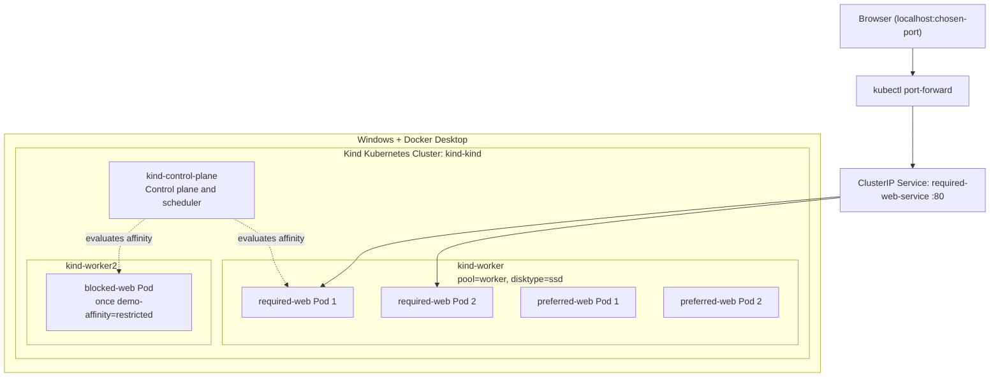
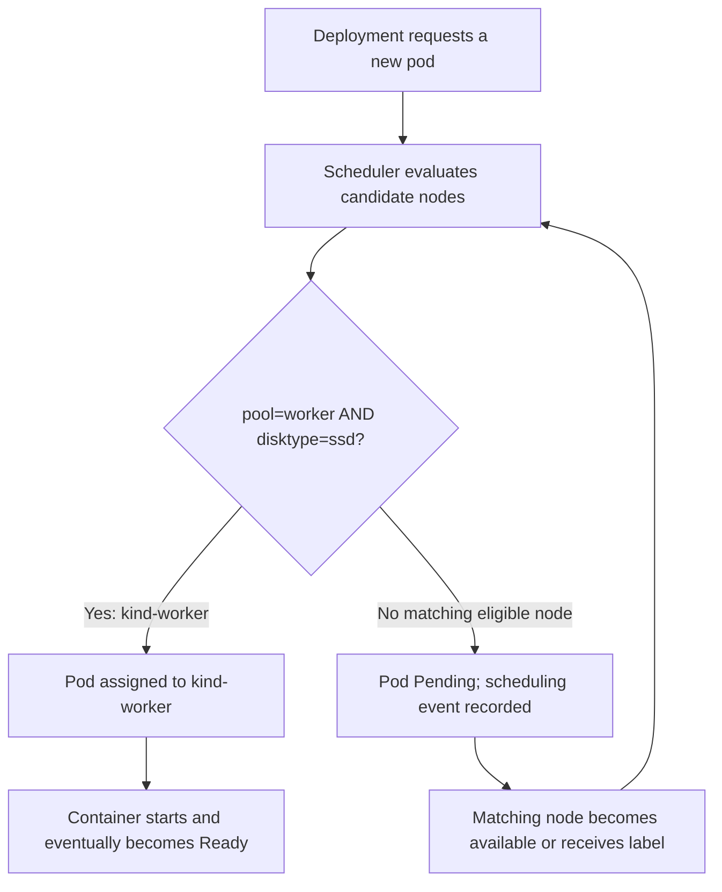
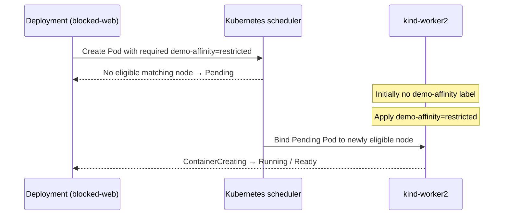

# Pod Scheduling Using Node Affinity in Kubernetes


> **Project outcome:** A three-node local Kubernetes cluster successfully schedules Nginx workloads using **required** and **preferred** node affinity. The experiments also demonstrate a pod remaining **Pending** when no node matches, recovery after a matching label is introduced, and automatic replacement of deleted pods on an eligible node.

## Contents

1. [Problem statement and objectives](#1-problem-statement-and-objectives)
2. [Tools and environment](#2-tools-and-environment)
3. [Architecture](#3-architecture)
4. [Kubernetes and node affinity fundamentals](#4-kubernetes-and-node-affinity-fundamentals)
5. [Repository structure](#5-repository-structure)
6. [Reproduce the implementation](#6-reproduce-the-implementation)
7. [Experiments and recorded results](#7-experiments-and-recorded-results)
8. [Screenshot evidence](#8-screenshot-evidence)
9. [Verification and demo commands](#9-verification-and-demo-commands)
10. [Troubleshooting](#10-troubleshooting)
11. [Viva questions](#11-viva-questions)
12. [Conclusion and references](#12-conclusion-and-references)

---

## 1. Problem statement and objectives

### Assigned university problem statement

> Deploy an application in a multi-node Kubernetes cluster and configure node affinity so that selected pods are scheduled only on nodes that satisfy specified labels.

**Implementation expected by the evaluation brief:** Label worker nodes, define required or preferred node affinity in a Deployment, deploy pods, and verify placement with `kubectl get pods -o wide` and node descriptions.

**Evidence expected:** Pod placement, scheduling events, affinity-rule behavior, and successful scheduling of replacement pods after deletion/recreation.

### Objectives

- Use a **multi-node Kubernetes cluster** (one control-plane node, two workers).
- Label worker nodes with illustrative disk characteristics.
- Demonstrate **hard (required)** and **soft (preferred)** node affinity.
- Prove that an unsatisfiable required rule keeps a newly created pod **Pending**.
- Show that adding a matching label makes that pod eligible for scheduling.
- Delete Deployment-managed pods and verify that their replacements are again placed on an eligible node.
- Expose a running Nginx application through a ClusterIP Service and local port forwarding.

## 2. Tools and environment

| Component | Used in this project | Purpose |
| --- | --- | --- |
| Host | Windows 11 with WSL 2 | Local development environment |
| Docker Desktop | Docker CLI 29.8.0 observed | Container engine for Kind |
| Kind | Existing `kind-kind` cluster | Kubernetes-in-Docker, multi-node environment |
| Kubernetes | v1.37.0 (reported by all three nodes) | Cluster management and scheduling |
| kubectl | v1.36.1 client observed | Manage and inspect Kubernetes resources |
| Container runtime | containerd 2.3.4 (reported by nodes) | Run containers inside Kind nodes |
| Nginx | `nginx:stable-alpine` | Lightweight demonstration web server |
| PowerShell | Windows terminal | Cluster and deployment commands |
| YAML | Kubernetes manifests | Declarative resource specifications |

**Important:** This project **uses Kind, not Minikube**. Minikube was installed during preparation, but the already-running Kind cluster met the three-node requirement and was used for the actual implementation.

### Observed cluster

| Node | Role | Label `pool` | Label `disktype` | Outcome |
| --- | --- | --- | --- | --- |
| `kind-control-plane` | Control plane | — | — | `Ready` |
| `kind-worker` | Worker | `worker` | `ssd` | `Ready`; receives required SSD pods |
| `kind-worker2` | Worker | `worker` | `hdd` | `Ready`; receives restricted demo pod after labeling |

The additional label `demo-affinity=restricted` was applied to `kind-worker2` **during the recovery experiment**.

> **Labeling disclaimer:** The `ssd` and `hdd` labels are manually assigned **demonstration metadata**. They do **not** prove that the Docker-based nodes have different physical disk hardware.

## 3. Architecture

### 3.1 Deployment and networking architecture



**Read the diagram carefully:** `required-web-service` selects **only** pods labeled `app=required-web`. The preferred and blocked Deployments are separate scheduling demonstrations; the Service does **not** automatically expose them.

### 3.2 Required affinity decision flow



The required-affinity rule is a scheduling filter. Preferred affinity instead contributes a **weighted preference** to node scoring; it is not a strict placement guarantee.

### 3.3 Scheduling failure and recovery



## 4. Kubernetes and node affinity fundamentals

| Term | Meaning in this project |
| --- | --- |
| **Cluster** | Multiple Kubernetes nodes managed together. |
| **Control plane** | Hosts components that manage cluster state; the scheduler selects nodes for new pods. |
| **Worker node** | Runs application pods. Our two workers are named `kind-worker` and `kind-worker2`. |
| **Pod** | Smallest deployable Kubernetes unit; each demo pod contains one Nginx container. |
| **Deployment** | Maintains a desired number of replicas by creating and replacing pods through ReplicaSets. |
| **Replica** | An instance of an application pod, e.g., two `required-web` pods. |
| **Node label** | Key/value metadata such as `disktype=ssd` used in scheduling rules. |
| **nodeSelector** | Simple, exact-match node-label constraint. |
| **Node affinity** | More expressive scheduler rules based on node labels. |
| **Service** | Stable in-cluster network endpoint for matching pods; here `required-web-service`. |
| **Namespace** | Logical scope that isolates our resources; `affinity-demo`. |
| **Pending** | Pod has not been assigned to a suitable node (or is otherwise waiting for preparation). In our failure experiment the `NODE` column was `<none>`. |
| **ContainerCreating** | Pod has been assigned to a node but the container is still being prepared. This is **not** the same as a scheduling failure. |

### Required versus preferred node affinity

| Property | Required affinity | Preferred affinity |
| --- | --- | --- |
| Kubernetes key | `requiredDuringSchedulingIgnoredDuringExecution` | `preferredDuringSchedulingIgnoredDuringExecution` |
| Meaning | Hard constraint: node must match | Soft preference: matching node is favored |
| If no node matches | Pod can remain `Pending` | Pod may run on another eligible node |
| Demo configuration | `disktype In [ssd]` | Prefer `disktype In [ssd]`, `weight: 100` |
| Observed result | Both `required-web` replicas ran on `kind-worker` | Both `preferred-web` replicas also ran on `kind-worker` |

**Why include both `nodeSelector` and node affinity?** All three manifests require `pool=worker` via `nodeSelector`. Any required affinity is an **additional** constraint. This keeps the demonstration workloads on labeled worker nodes, rather than accidentally considering the control-plane node. Preferred affinity does not override the `nodeSelector` requirement.

**What does `IgnoredDuringExecution` mean?** The scheduler enforces affinity at **initial scheduling**. If labels change later, the affinity rule by itself does **not** evict or automatically move an already-running pod. To test a *new* placement after removing a label, delete a Deployment-managed pod so its replacement is scheduled again.

**What is `operator: In`?** A node's matching label must have one of the listed values. Other operators include `NotIn`, `Exists`, `DoesNotExist`, `Gt`, and `Lt`.

**Why a preferred weight of 100?** For the preferred term, 100 is the maximum term weight and signals a strong preference in scheduler scoring. It is **not** a 100% guarantee that the pod will land on that node.

**What is a scheduling event?** `kubectl describe pod` can expose a `FailedScheduling` event and its reason when a pod cannot be placed. The supplied screenshots show a Pending pod, but do **not** capture the actual `FailedScheduling` event text (see [Evidence notes](#evidence-notes)).

## 5. Repository structure

```text
Cloud-Node-Affinity/
├── README.md
├── kind-config.yaml                  # Optional 3-node Kind cluster setup
├── manifests/
│   ├── required-affinity.yaml        # 2 replicas + ClusterIP Service
│   ├── preferred-affinity.yaml       # 2 replicas, weighted SSD preference
│   └── unmatched-affinity.yaml       # 1 replica, required demo label
└── screenshots/
    ├── 01-cluster-and-node-labels.png
    ├── 02-required-affinity-pods.png
    ├── 03-unmatched-affinity-pending.png
    ├── 04-affinity-label-added.png
    ├── 05-pending-after-pod-recreation.png
    ├── 06-scheduling-recovery-running.png
    ├── 07-pod-rescheduling-and-service.png
    └── 08-nginx-browser.png
```

The three manifest files mirror the configurations used in this evaluation walkthrough. The screenshots are original uploaded evidence, copied and renamed to make GitHub links readable.

## 6. Reproduce the implementation

> Run commands from **PowerShell**. For an existing cluster, keep the `kind-kind` context and **skip creating another cluster**. Do not paste the `PS C:\...>` prompt into commands.

### 6.1 Prerequisites

- Docker Desktop is started and uses its Linux container engine.
- `kubectl` is installed and can reach a Kubernetes cluster.
- Kind is required **only** if you need to create a new cluster from scratch.

```powershell
# Docker engine should return: linux
docker info --format '{{.OSType}}'

# Inspect active context and nodes
kubectl config get-contexts
kubectl --context kind-kind get nodes -o wide
```

**Optional clean-cluster setup:** If you have no Kind cluster and have the `kind` CLI installed, create one with the included config file:

```powershell
kind create cluster --name kind --config kind-config.yaml
kubectl config use-context kind-kind
kubectl get nodes
```

**Do not run `kind create cluster` if `kind-kind` already exists.** In the completed evaluation, the existing Kind cluster had all three nodes in `Ready` state.

### 6.2 Set node labels

```powershell
kubectl config use-context kind-kind
kubectl label node kind-worker pool=worker disktype=ssd --overwrite
kubectl label node kind-worker2 pool=worker disktype=hdd --overwrite
kubectl get nodes -L pool,disktype
```

A `node/... not labeled` message with `--overwrite` can simply mean the requested values were already present. Confirm actual values with `kubectl get nodes -L ...`.

### 6.3 Create the project namespace

```powershell
kubectl create namespace affinity-demo
```

If it already exists, skip creating it again. Confirm with `kubectl get namespaces`.

### 6.4 Experiment A — required node affinity

**File:** [`manifests/required-affinity.yaml`](manifests/required-affinity.yaml)

Key scheduling section:

```yaml
nodeSelector:
  pool: worker
affinity:
  nodeAffinity:
    requiredDuringSchedulingIgnoredDuringExecution:
      nodeSelectorTerms:
        - matchExpressions:
            - key: disktype
              operator: In
              values: [ssd]
```

The Deployment requests **2 replicas** of Nginx. The included Service selects `app=required-web` and exposes port 80 **inside the cluster**.

```powershell
kubectl apply -n affinity-demo -f manifests/required-affinity.yaml
kubectl rollout status deployment/required-web -n affinity-demo --timeout=120s
kubectl get deployments -n affinity-demo
kubectl get pods -n affinity-demo -l app=required-web -o wide
```

**Expected:** Both pods become `1/1 Running` and display `kind-worker` in the `NODE` column, because it is the SSD-labeled worker. A `0/2` Deployment immediately after creation or temporary `ContainerCreating` is normal while the image starts.

### 6.5 Experiment B — preferred node affinity

**File:** [`manifests/preferred-affinity.yaml`](manifests/preferred-affinity.yaml)

```yaml
affinity:
  nodeAffinity:
    preferredDuringSchedulingIgnoredDuringExecution:
      - weight: 100
        preference:
          matchExpressions:
            - key: disktype
              operator: In
              values: [ssd]
```

```powershell
kubectl apply -n affinity-demo -f manifests/preferred-affinity.yaml
kubectl rollout status deployment/preferred-web -n affinity-demo --timeout=120s
kubectl get pods -n affinity-demo -l app=preferred-web -o wide
```

**Observed in this run:** Both preferred pods were scheduled on `kind-worker`. This is consistent with the preference but **does not prove** that the preference is mandatory. Unlike required affinity, preferred affinity permits placement on a different worker node when other scheduling factors prevail.

### 6.6 Experiment C — unmatched required affinity produces a Pending pod

**File:** [`manifests/unmatched-affinity.yaml`](manifests/unmatched-affinity.yaml)

```yaml
affinity:
  nodeAffinity:
    requiredDuringSchedulingIgnoredDuringExecution:
      nodeSelectorTerms:
        - matchExpressions:
            - key: demo-affinity
              operator: In
              values: [restricted]
```

Before deploying, ensure **no worker has** `demo-affinity=restricted`:

```powershell
kubectl get nodes -L pool,disktype,demo-affinity
```

If `kind-worker2` has that label from a previous experiment, remove it:

```powershell
kubectl label node kind-worker2 demo-affinity-
```

Create the demo workload:

```powershell
kubectl apply -n affinity-demo -f manifests/unmatched-affinity.yaml
kubectl get pods -n affinity-demo -l app=blocked-web -o wide
kubectl describe pods -n affinity-demo -l app=blocked-web
```

**Expected:** `blocked-web` shows `0/1 Pending`, `NODE <none>`, and (when retrieved) a scheduling event explaining why no suitable node was found. In the uploaded evidence, the Pending state is directly visible.

If `blocked-web` was already scheduled **before** you removed a node label, it will generally **stay assigned**, because this is an `IgnoredDuringExecution` rule. To reproduce the Pending state with a fresh pod:

```powershell
kubectl delete pods -n affinity-demo -l app=blocked-web
kubectl get pods -n affinity-demo -l app=blocked-web -o wide
```

### 6.7 Experiment D — recover scheduling by adding a label

```powershell
kubectl label node kind-worker2 demo-affinity=restricted --overwrite
kubectl get nodes -L pool,disktype,demo-affinity
kubectl get pods -n affinity-demo -l app=blocked-web -o wide
```

**Expected progression:** `Pending` → scheduled on `kind-worker2` → `ContainerCreating` → `1/1 Running`.

The new label `demo-affinity=restricted` is **additional** to the existing `disktype=hdd` label. The HDD label is not changed in this experiment.

### 6.8 Experiment E — automatic pod recreation preserves affinity

A Deployment tries to maintain its desired number of pod replicas. Deleting its pods causes replacement pods to be created and **scheduled afresh**.

```powershell
# Record existing pod names first
kubectl get pods -n affinity-demo -l app=required-web -o wide

# Delete only the pods managed by this demonstration Deployment
kubectl delete pods -n affinity-demo -l app=required-web

# Check rollout and replacement placement
kubectl rollout status deployment/required-web -n affinity-demo --timeout=120s
kubectl get pods -n affinity-demo -l app=required-web -o wide
```

**Observed:** The deleted pod identities were replaced with new pod identities; both new required pods again became `1/1 Running` on `kind-worker`. This tests scheduling after **pod recreation** rather than an in-place container restart.

### 6.9 Experiment F — access the Nginx Service in a browser

```powershell
kubectl get services -n affinity-demo
kubectl port-forward -n affinity-demo svc/required-web-service :80
```

The `:80` syntax lets kubectl choose an **available local port**, avoiding collisions on fixed ports such as 8080 or 9090. Example (the chosen port will differ):

```text
Forwarding from 127.0.0.1:64624 -> 80
```

Open `http://localhost:<chosen-port>` while the port-forward command remains running. The screenshot shows the **Welcome to nginx!** page.

**Why use a Service?** The Service selects pods labeled `app=required-web` and offers a stable in-cluster endpoint for reaching them. Port forwarding provides local development access without requiring a public LoadBalancer or Ingress.

## 7. Experiments and recorded results

These are observations from the uploaded screenshots and the terminal outputs recorded during the lab. They are **not simulated benchmark figures**.

| Test | Configuration / action | Observed outcome | Interpretation |
| --- | --- | --- | --- |
| Cluster | Kind with 1 control plane + 2 workers | All three nodes `Ready` | Multi-node prerequisite met |
| Labels | `kind-worker: ssd`; `kind-worker2: hdd` | Labels visible in node output | Nodes are distinguishable for scheduling |
| Required affinity | 2 replicas; `disktype In [ssd]` | Both `required-web` pods `Running` on `kind-worker` | Hard affinity honored |
| Preferred affinity | 2 replicas; SSD preferred, weight 100 | Both `preferred-web` pods `Running` on `kind-worker` | Preference was satisfied in this run |
| Required mismatch | `demo-affinity In [restricted]`, no matching label | `blocked-web` `Pending`, `NODE <none>` | No eligible node at scheduling time |
| Label recovery | Add `demo-affinity=restricted` to `kind-worker2` | Pod assigned to `kind-worker2`, then `Running` | Newly matching node enables placement |
| Pod recreation | Delete `required-web` pods | Replacement pods `Running` on `kind-worker` | Deployment restored replicas; hard affinity still honored |
| Application access | ClusterIP Service + port forwarding | Nginx welcome page displayed | Workload is accessible through Service forwarding |

The `blocked-web` name is retained even once it is no longer blocked; it is only a Deployment name, not a live status indicator.


### Evidence notes

- The screenshot set shows `Pending` and `<none>` node placement, and includes a terminal command invoking `kubectl describe`, **but does not show the actual `FailedScheduling` event output**. To add that specific evidence for evaluation, reproduce the Pending experiment and capture:

  ```powershell
  kubectl describe pods -n affinity-demo -l app=blocked-web
  ```

  Include the **Events** section in an additional screenshot, e.g. `screenshots/09-failed-scheduling-event.png`. Do not label an unrelated screenshot as an event capture.
- The screenshots of a pod becoming `ContainerCreating` and later `Running` come from the same type of recovery experiment; separate runs may have different pod names. Pod names and IPs are ephemeral.
- The browser screenshot verifies that Nginx is served; it does **not** by itself prove affinity. Use the pod-placement screenshots for scheduler evidence.

## 9. Verification and demo commands

The following commands form a compact checklist for demonstrating the project live:

```powershell
# Cluster identity and readiness
kubectl config current-context
kubectl get nodes -o wide

# Worker-node capabilities used by affinity
kubectl get nodes -L pool,disktype,demo-affinity

# All workloads, assigned nodes, and readiness
kubectl get deployments -n affinity-demo
kubectl get pods -n affinity-demo -o wide

# Show the rules in the actual running workloads
kubectl describe deployment required-web -n affinity-demo
kubectl describe deployment preferred-web -n affinity-demo
kubectl describe deployment blocked-web -n affinity-demo

# Inspect scheduling events
kubectl get events -n affinity-demo --sort-by=.metadata.creationTimestamp
kubectl describe pods -n affinity-demo -l app=blocked-web

# Verify the Service
kubectl get service required-web-service -n affinity-demo
kubectl get endpoints required-web-service -n affinity-demo
```

For the best evaluator demo, show **node labels → required placement → Pending mismatch → matching label added → Running placement → deleted pod replaced → browser result**. Events are easiest to demonstrate while the mismatch is active.

## 10. Troubleshooting

| Symptom | Likely explanation | Suggested check / remedy |
| --- | --- | --- |
| `docker` cannot connect to the Linux engine | Docker Desktop backend not running | Start Docker Desktop; verify `docker info --format '{{.OSType}}'` returns `linux`. |
| `node/... not labeled` with `--overwrite` | Label already has the requested value | Verify with `kubectl get nodes -L pool,disktype`. |
| `required-web 0/2` shortly after apply | Containers not Ready yet | Check `kubectl get pods ... -o wide`; inspect events if it persists. |
| `ContainerCreating` | Image or runtime/network setup in progress | `kubectl describe pod <name> -n affinity-demo`; inspect `Events`. |
| `ImagePullBackOff` | Image cannot be pulled | Inspect pod events and image name, and check network access. |
| `blocked-web` unexpectedly starts on worker 2 | Matching label may still exist | Check `kubectl get nodes -L demo-affinity` and live Deployment YAML. |
| Removing label doesn't move a Running pod | `IgnoredDuringExecution` | Delete only that Deployment's pod to test fresh scheduling. |
| Required pod stays Pending | No node matches all hard constraints | Inspect node labels, `pool=worker`, resources, taints, and pod events. |
| Port 8080 or 9090 already in use | Another local process holds the port | Use `kubectl port-forward ... :80` for an automatically chosen port. |
| PowerShell shows `>>` / `Unexpected token` | Previous prompts/output pasted as commands | Press `Ctrl+C`; enter **only** one command, without `PS ...>` prefix. |
| Namespace already exists | Lab has already created it | Reuse `affinity-demo` rather than recreating it. |


## 12. Conclusion 

The experiment meets the assigned lab's core requirements using a **three-node Kind Kubernetes cluster**. Required affinity constrained two Nginx replicas to the labeled SSD worker. Preferred affinity favored that same worker, and the scheduler placed both preferred replicas there during this run. An unmatched required rule produced a Pending pod; adding the matching label enabled scheduling on the second worker. Kubernetes also recreated deleted Deployment-managed pods while preserving their required placement constraints. Finally, the Nginx application was verified through a Kubernetes Service and port forwarding.

**Scope:** This lab demonstrates scheduling policies and their observable outcomes. It does not measure real SSD/HDD performance or guarantee preferred-node placement under all load conditions.


